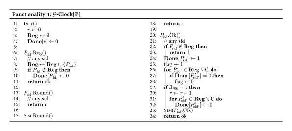

  <h3 align="center">gclock-model-checking</h3>
  

    Model-Checking the UC-Realizability of the G-Clock Ideal Functionality in the Real World with Quint
  

## About 

This project is being developed as part of my MsC thesis in Computer Science at Faculdade de Ciências da Universidade do Porto, entitled _From Ideal Clocks to Buildable Ones_. The goal is to verify if real-world distributed protocols can satisfy the _G-Clock_ ideal functionality.

## Verification (in progress)

Let there be two honest parties P1 and P2 registered with G-Clock.

We model two scenarios:
- One where P1 is corrupted and P2 sends Ok to G-Clock.
- Another where P1 is honest but silent and P2 sends Ok to G-Clock.

Our model will prove that the environment Z can distinguish the ideal world's execution from the real one's by running the two scenarios since:
- In the ideal world, G-Clock knows the corruption status of each party and will advance in the first case but not in the second. 
- In the real world, modelling clock synchronization over bounded-delay channels, the rounds will be the same for both cases.

## UC-framework in Quint

In Quint, each machine was modelled as a record with input, output, and incoming-message tapes. Depending on if a machine is a child/parent of another one, or if it corresponds to a global functionality, it has different rules for which machines can it write to and who can to it.

### Read/Write rules
#### Ideal World
- The environment can write to the parties’ input tapes, and parties can write to the environment’s output tape.
- The simulator can write to F's incoming-message tape. Conversely, F can write to the simulator’s incoming-message tape, modelling leakage.
- Parties can write to the global functionality’s input tape, and the functionality can write to the parties’ output tapes.

#### Real World with Hybrid Execution
- Parties can write to the input tape of dummy parties with id (pid, sid) and those dummy parties to the output tape of the parties. dummy parties can write to the input tape of F with sid and F to the output tape of the dummy parties. The adversary A can send messages to the incomming-messages tape of all of them and receive from them in its own.
- A can write to the incomming-messages tape of the parties. Conversely, parties can write to the simulator’s incoming-message tape.
- All other rules are similar to the ideal world ones.

## Ideal World

The ideal-world model has four main components:
- **Environment (Z):** Registers parties and requests rounds or OK (on behalf of them) and can query the simulator to corrupt a parties.
- **G-Clock:** Tracks registered parties, corruptions, readiness, and the current round.
- **Simulator (S):** Requests round advances and party corruptions.
- **Parties (P):** Forward requests to the clock and return its responses.

### G-Clock

The G-Clock model is based on the _Crossing with Confidence: Formal Analysis and Model Checking of Blockchain Bridges_ paper. For party corruption, the adaptive-corruption approach from _Universally Composable Synchronous Computation_ was followed, where parties can be corrupted during execution rather than being fixed as corrupted from the start.

The clock maintains a round counter, a set of registered parties, a set of corrupted parties, and a readiness flag (done) for each party.

### Properties

To prove the G-Clock's correctness, the following properties where checked (mostly based on the _Crossing with Confidence: Formal_ paper).

#### Time Agreement

_If two parties query the time and no OK requests have been sent in the middle then G-clock responds with the same time._

#### Time Liveness
_If all registered honest parties are ready, then time advances._

#### Time Soundness
_If time advanced then all currently registered honest parties were ready._

#### Results

All tests were ran on a M4 Macbook Air with 16GB of RAM using the TLC backend and Quint 0.32.0. 

<table>
  <thead>
    <tr>
      <th>Property</th>
      <th>Parties</th>
      <th>Corrupted</th>
      <th>Rounds</th>
      <th>Verification Time</th>
      <th>Distinct States Generated</th>
    </tr>
  </thead>
  <tbody>
    <tr>
      <td>Time Agreement</td>
      <td>3</td>
      <td>1</td>
      <td>5</td>
      <td>21s</td>
      <td>492 928</td>
    </tr>
    <tr>
      <td>Time Liveness</td>
      <td>3</td>
      <td>1</td>
      <td>5</td>
      <td>21s</td>
      <td>492 928</td>
    </tr>
    <tr>
      <td>Time Soundness</td>
      <td>3</td>
      <td>1</td>
      <td>5</td>
      <td>21s</td>
      <td>492 928</td>
    </tr>
  </tbody>
</table>

## Real World

Work in progress.

## References
- [UC framework and rules](https://swayam-padhy.gitbook.io/)
- [GClock Model Cheching](https://eprint.iacr.org/2026/292.pdf)
- [UC Synchrony and adaptive corruption](https://eprint.iacr.org/2011/310.pdf)
- [Quint cheatsheet](https://quint.sh/quint-cheatsheet.pdf)
