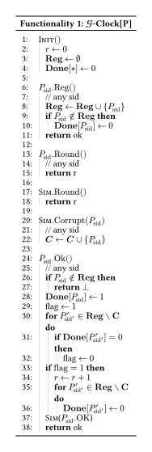

  <h3 align="center">gclock-model-checking</h3>
  

    Model-Checking the Realizability of the G-Clock Ideal Functionality in Quint
  

## About 

This project is being developed as part of my MsC thesis in Computer Science at Faculdade de Ciências da Universidade do Porto, entitled _From Ideal Clocks to Buildable Ones_. The goal is to verify if real-world distributed protocols can satisfy the _G-Clock_ ideal functionality.

## UC-framework in Quint

In Quint, each machine was modelled as a state record with input, output, and incoming-message tapes. Depending on if a machine is a child/parent of another one, or if it corresponds to a global functionality, it has different rules for which machines can it write to and who can to it.

### Read/Write rules
- The environment can write to the parties’ input tapes, and parties can write to the environment’s output tape.
- The simulator can write to the parties’ incoming-message tapes. Conversely, parties can write to the simulator’s incoming-message tape, modeling leakage.
- Parties can write to the global functionality’s input tape, and the functionality can write to the parties’ output tapes.

## Ideal World

The ideal-world model has four main components:
- **Environment (Z):** Registers parties and requests rounds or OK (on behalf of them) and can query the simulator to corrupt a parties.
- **G-Clock:** Tracks registered parties, corruptions, readiness, and the current round.
- **Simulator (S):** Requests round advances and party corruptions.
- **Parties (P):** Forward requests to the clock and return its responses.

### G-Clock

The G-Clock model is based on the _Crossing with Confidence: Formal Analysis and Model Checking of Blockchain Bridges_ paper. For party corruption, the adaptive-corruption approach from _Universally Composable Synchronous Computation_ was followed, where parties can be corrupted during execution rather than being fixed as corrupted from the start.

The clock maintains a round counter, a set of registered parties, a set of corrupted parties, and a readiness flag (done) for each party.

### Properties

To prove the G-Clock's correctness, the following properties where checked (mostly based on the _Crossing with Confidence: Formal_ paper).

#### Time Agreement

_If two parties query the time and no OK requests have been sent in the middle then G-clock responds with the same time._

#### Time Liveness
_If all registered parties are ready, then time advances. This is non-trivial since we have to track who was registered and corrupted at all times._

#### Time Soundness
_If time advanced then all currently registered honest parties were ready._

#### Results

All tests were ran on a M4 Macbook Air with 16GB of RAM using the TLC backend and Quint 0.32.0. 

<table>
  <thead>
    <tr>
      <th>Property</th>
      <th>Parties</th>
      <th>Corrupted</th>
      <th>Rounds</th>
      <th>Verification Time</th>
      <th>Distinct States Generated</th>
    </tr>
  </thead>
  <tbody>
    <tr>
      <td>Time Agreement</td>
      <td>3</td>
      <td>1</td>
      <td>5</td>
      <td>21s</td>
      <td>492 928</td>
    </tr>
    <tr>
      <td>Time Liveness</td>
      <td>3</td>
      <td>1</td>
      <td>5</td>
      <td>21s</td>
      <td>492 928</td>
    </tr>
    <tr>
      <td>Time Soundness</td>
      <td>3</td>
      <td>1</td>
      <td>5</td>
      <td>21s</td>
      <td>492 928</td>
    </tr>
  </tbody>
</table>

## Real World

Work in progress.

## References
- [UC framework and rules](https://swayam-padhy.gitbook.io/)
- [GClock Model Cheching](https://eprint.iacr.org/2026/292.pdf)
- [UC Synchrony and adaptive corruption](https://eprint.iacr.org/2011/310.pdf)
- [Quint cheatsheet](https://quint.sh/quint-cheatsheet.pdf)
